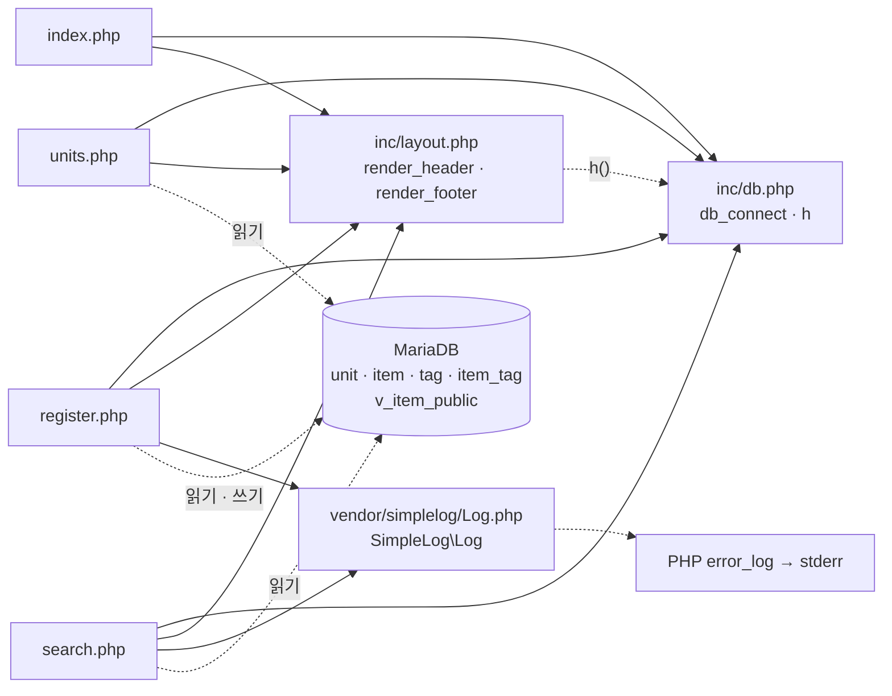

# item-bank-php 아키텍처

분석 대상: `legacy/item-bank-php/` (읽기 전용 분석, 코드 수정 없음)
분석 범위: 진입점 · 의존 관계. 데이터 흐름 · 비즈니스 규칙은 아직 분석하지 않았다.
근거 표기 `파일:줄번호` 의 경로는 모두 `legacy/item-bank-php/` 기준이다.

## 1. 모듈 개요

- 문항 은행 레거시 화면이다. PHP 7.4 + Apache + mysqli 로 동작한다(`Dockerfile:1,3`).
- 화면은 홈 · 문항 검색 · 문항 등록 · 단원 목록 네 개이고, 각 `.php` 파일이 곧 URL 이다(`index.php:9-11`).
- 공통 코드는 `inc/`(DB 연결 · HTML 이스케이프 · 레이아웃), 외부 라이브러리는 `vendor/simplelog`(로그) 하나다.
- 코드 대부분은 `search.php` 에 있고, 그중 `buildSearchQuery` 한 함수가 523줄이다(`search.php:42-564`).

## 2. 폴더 구조

```
legacy/item-bank-php/
├── Dockerfile               16줄  php:7.4-apache, mysqli, 모듈 전체를 /var/www/html 로 복사
├── index.php                14줄  홈 메뉴
├── search.php              731줄  문항 검색 (함수 4개 + 실행부)
├── register.php            177줄  문항 등록 (함수 없음, 최상위 스크립트)
├── units.php                48줄  단원 목록 (함수 없음, 최상위 스크립트)
├── inc/
│   ├── db.php               37줄  db_connect(), h()
│   └── layout.php           43줄  render_header(), render_footer()
└── vendor/
    └── simplelog/
        └── Log.php          54줄  SimpleLog\Log (외부 라이브러리, 수정 금지 주석 Log.php:3)
```

모듈 루트에는 `.htaccess` · `composer.json` · 빌드 산출물이 없다.

## 3. 진입점

`Dockerfile:14` 가 모듈 전체를 `/var/www/html/` 에 복사하고, 컨테이너는 80 포트를 연다(`Dockerfile:16`).

| URL / 화면 | 처음 실행되는 파일 | 호출하는 주요 함수 |
|---|---|---|
| `/`, `/index.php` · 홈 메뉴 | `index.php` | `render_header('홈')` `index.php:5`, `render_footer()` `index.php:14`. DB 는 쓰지 않는다(`inc/db.php` 를 포함만 함, `index.php:2`) |
| `/units.php` · 단원 목록 | `units.php` | `render_header` `units.php:5` → `db_connect` `units.php:8` → `$conn->query` `units.php:20` → `h` `units.php:40-43` → `render_footer` `units.php:48` |
| `/register.php` GET · 등록 폼 | `register.php` | `db_connect` `register.php:17` → `$conn->query` ×2(단원 · 태그 목록) `register.php:27,34` → `render_header` `register.php:127` → 폼 출력 `register.php:141-175` → `render_footer` `register.php:177` |
| `/register.php` POST · 등록 처리 | `register.php` | 검증 `register.php:47-81` → `begin_transaction` `register.php:85` → `query`(MAX id) `register.php:87` → `prepare`/`bind_param`/`execute` `register.php:92-113` → `commit` `register.php:114` / `rollback` `register.php:120` → `Log::info` `register.php:115` / `Log::error` `register.php:121` |
| `/search.php` · 문항 검색 | `search.php` | `render_header` `search.php:709` → `db_connect` `search.php:713` → `buildSearchQuery($_GET, $conn)` `search.php:722` → `renderSearchForm` `search.php:723` → `runSearchQuery` `search.php:724` → `renderResultTable` `search.php:725` → `render_footer` `search.php:731` |

## 4. 의존 관계

### 4.1 그림

화살표는 "A → B (A 가 B 를 포함하거나 호출)"를 뜻한다. 실선은 `require_once`, 점선은 함수 호출이나 DB 접근이다.



### 4.2 파일 포함 (`require_once`)

| A → B | 근거 |
|---|---|
| `index.php` → `inc/db.php` | `index.php:2` |
| `index.php` → `inc/layout.php` | `index.php:3` |
| `units.php` → `inc/db.php` | `units.php:2` |
| `units.php` → `inc/layout.php` | `units.php:3` |
| `register.php` → `inc/db.php` | `register.php:2` |
| `register.php` → `inc/layout.php` | `register.php:3` |
| `register.php` → `vendor/simplelog/Log.php` | `register.php:4` (`use` `register.php:6`) |
| `search.php` → `inc/db.php` | `search.php:20` |
| `search.php` → `inc/layout.php` | `search.php:21` |
| `search.php` → `vendor/simplelog/Log.php` | `search.php:22` (`use` `search.php:24`) |

### 4.3 함수 호출 (파일 경계를 넘는 것)

| A → B | 호출 | 근거 |
|---|---|---|
| `inc/layout.php` → `inc/db.php` | `h()` | `inc/layout.php:17,33` |
| `units.php` → `inc/db.php` | `db_connect()` | `units.php:8` |
| `register.php` → `inc/db.php` | `db_connect()` | `register.php:17` |
| `search.php` → `inc/db.php` | `db_connect()` | `search.php:713` |
| `units.php` · `register.php` · `search.php` → `inc/db.php` | `h()` | `units.php:10,40-43`, `register.php:20,131,136,144…`, `search.php:360,416…` |
| 네 페이지 → `inc/layout.php` | `render_header()` | `index.php:5`, `units.php:5`, `register.php:19,127`, `search.php:709` |
| 네 페이지 → `inc/layout.php` | `render_footer()` | `index.php:14`, `units.php:11,23,48`, `register.php:21,177`, `search.php:717,731` |
| `register.php` → `vendor/simplelog/Log.php` | `Log::info` | `register.php:115` |
| `register.php` → `vendor/simplelog/Log.php` | `Log::error` | `register.php:121` |
| `search.php` → `vendor/simplelog/Log.php` | `Log::setThreshold` | `search.php:27` |
| `search.php` → `vendor/simplelog/Log.php` | `Log::debug` | `search.php:103,528` |
| `search.php` → `vendor/simplelog/Log.php` | `Log::error` | `search.php:537,727` |
| `vendor/simplelog/Log.php` → PHP 내장 | `error_log()` | `Log.php:52`, 출력 대상 `Dockerfile:11` |

참고할 점:

- **포함 순서에 기댄다.** `inc/layout.php` 는 `h()` 를 부르지만 `inc/db.php` 를 스스로 포함하지 않는다. 모든 페이지가 `db.php` 를 먼저 포함하는 순서(`index.php:2-3` 등)에 의존한다.
- **debug 로그는 찍히지 않는다.** `search.php:27` 이 threshold 를 INFO 로 두고 `Log.php:45` 가 그보다 낮은 레벨을 거른다. 따라서 `Log::debug`(`search.php:103,528`)는 출력되지 않는다.

### 4.4 `search.php` 내부 호출

| A → B | 근거 |
|---|---|
| 실행부 → `buildSearchQuery` | `search.php:722` |
| 실행부 → `renderSearchForm` | `search.php:723` |
| 실행부 → `runSearchQuery` | `search.php:724` |
| 실행부 → `renderResultTable` | `search.php:725` |

### 4.5 페이지 → DB 객체

| A → B | 근거 |
|---|---|
| `units.php` → `unit`, `item` (읽기) | `units.php:16-19` |
| `register.php` → `unit`, `tag` (읽기) | `register.php:27,34` |
| `register.php` → `item`, `item_tag` (쓰기) | `register.php:87,93,105` |
| `search.php` → `unit`, `tag` (읽기) | `search.php:125,156,178` |
| `search.php` → 뷰 `v_item_public` (읽기) | `search.php:522` |
| `search.php` → `item_tag`, `tag` (읽기, 태그 조건) | `search.php:244-245` |

DB 접속 정보는 환경변수로 받고, 없으면 compose 기본값을 쓴다(`inc/db.php:14-18`). 기본 비밀번호가 코드에 하드코딩돼 있다(`inc/db.php:18`).

## 5. 가장 긴 함수 3개

| 순위 | 파일 | 함수 | 시작–끝 | 줄 수 | 하는 일 |
|---|---|---|---|---|---|
| 1 | `search.php` | `buildSearchQuery` | 42–564 | 523 | GET 파라미터를 받아 검색 SQL · 바인딩값 · 폼/요약/정렬 링크 HTML · 경고를 한꺼번에 만든다. 선택 목록용 단원 · 태그 조회도 여기서 한다(`search.php:125,156,178`) |
| 2 | `search.php` | `renderResultTable` | 647–704 | 58 | 경고 · 요약, 건수, 결과 표, 페이지 링크를 출력한다 |
| 3 | `search.php` | `runSearchQuery` | 571–624 | 54 | 건수 SQL 과 페이지 SQL 을 prepared statement 로 차례로 실행해 `{total, rows}` 를 돌려준다 |

나머지 함수는 모두 30줄 이하다: `render_header` `inc/layout.php:7-36`, `db_connect` `inc/db.php:7-29`, `renderSearchForm` `search.php:629-641`. `register.php` 와 `units.php` 에는 함수가 없다.

## 6. 미확인 목록

| 항목 | 현재 아는 것 | 확인 방법 |
|---|---|---|
| 호스트 포트 8081 매핑 | `Dockerfile:16` 은 80 만 연다 | compose 파일 확인 |
| `a2enmod rewrite` 를 켜는 이유 | `Dockerfile:4` 에서 켜지만, 모듈 안에 rewrite 규칙이 없다 | 배포 설정 · 이력 확인 |
| `v_item_public` 뷰 정의 (무엇을 거르는지, `tag_names` 를 어떻게 만드는지) | `search.php:522` 에서 쓴다 | `db/mariadb/init/01-schema.sql` |
| 난이도를 비웠을 때 `level < 5` 가 붙는 것이 의도인지 | 주석은 "1~5 모두 포함"이라고 하지만 코드는 난이도 5 를 뺀다. 느슨한 비교 `==` 로 판정한다(`search.php:213-215`) | 운영 담당 확인, 스냅샷 비교 |
| 등록 id 계산의 동시성 | `MAX(id)+1 … FOR UPDATE` 를 트랜잭션 안에서 실행한다(`register.php:85,87`) | 동시 등록 테스트 |
