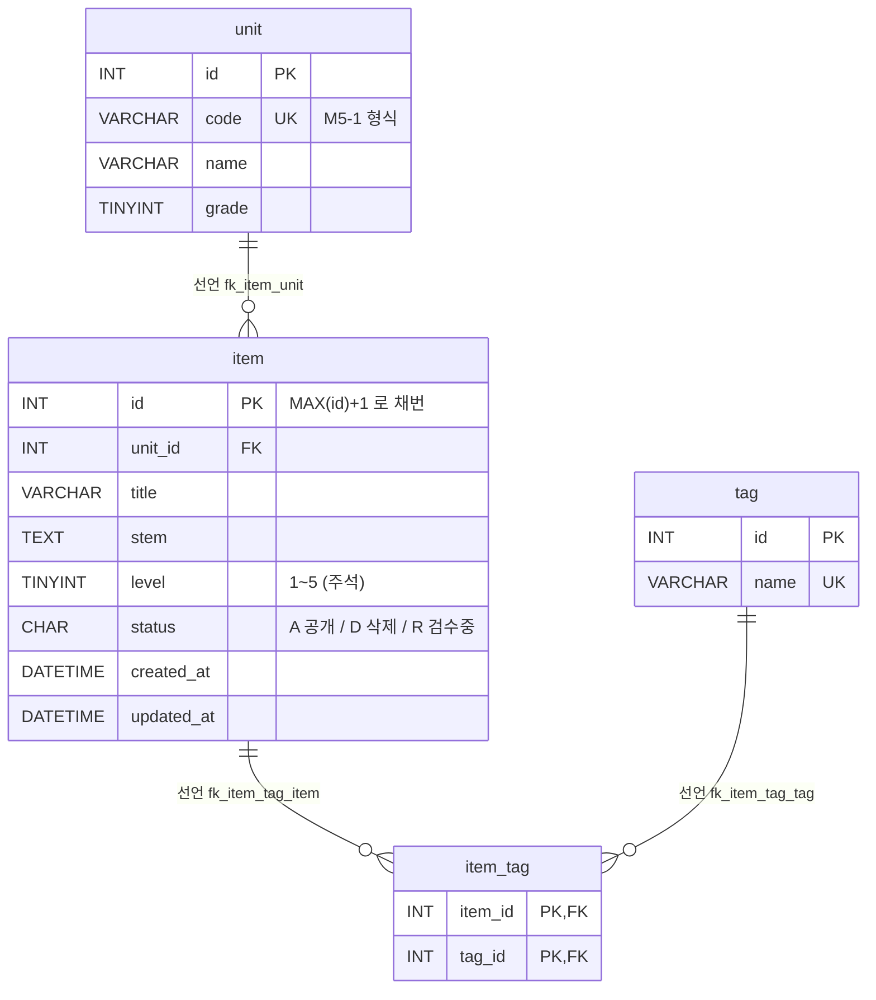
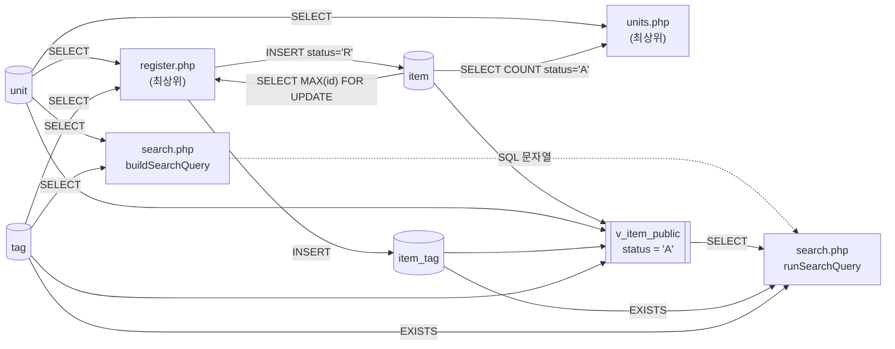

# item-bank-php 데이터 흐름 (ERD)

분석 대상: `legacy/item-bank-php/` (읽기 전용 분석, 코드 수정 없음). 선행 문서: `ARCHITECTURE.md`
분석 범위: 이 모듈이 읽고 쓰는 테이블 · 뷰, 테이블 관계, 읽기 · 쓰기 위치.
근거 표기: PHP 파일은 `legacy/item-bank-php/` 기준 경로, 스키마는 `db/mariadb/init/01-schema.sql`(아래 `schema`)이다.

## 1. 테이블 목록

이 모듈이 접근하는 DB 객체는 테이블 4개와 뷰 1개다. DB 이름은 `itembank`(`schema:5-6`, `inc/db.php:16`).

| 이름 | 종류 | 주요 컬럼 | 키 · 제약 | 근거 |
|---|---|---|---|---|
| `unit` | 테이블 | `id` INT, `code` VARCHAR(16), `name` VARCHAR(100), `grade` TINYINT | PK `id`, UNIQUE `code` | `schema:11-18` |
| `item` | 테이블 | `id` INT, `unit_id` INT, `title` VARCHAR(200), `stem` TEXT, `level` TINYINT(1~5, 주석), `status` CHAR(1) 기본 `'A'`(A 공개 · D 삭제 · R 검수중, 주석), `created_at` DATETIME, `updated_at` DATETIME | PK `id`, FK `unit_id`→`unit.id`, 인덱스 `unit_id` · `level` | `schema:20-33` |
| `tag` | 테이블 | `id` INT, `name` VARCHAR(50) | PK `id`, UNIQUE `name` | `schema:35-40` |
| `item_tag` | 테이블 | `item_id` INT, `tag_id` INT | 복합 PK (`item_id`, `tag_id`), FK 2개 | `schema:42-48` |
| `v_item_public` | 뷰 | `id`, `unit_id`, `unit_code`, `unit_name`, `unit_grade`, `title`, `stem`, `level`, `created_at`, `updated_at`, `tag_names`(태그 이름을 `tag.id` 순으로 `,` 로 이어 붙임) | `item JOIN unit`, 조건 `i.status = 'A'` | `schema:52-70` |

참고할 점:

- `id` 컬럼에 AUTO_INCREMENT 가 없다(`schema:12,21,36`). 문항 id 는 애플리케이션이 `MAX(id)+1` 로 정한다(`register.php:87`).
- `level` 의 1~5 범위와 `status` 의 코드 값은 주석일 뿐 CHECK 제약이 없다(`schema:25-26`). 범위 검증은 등록 화면 코드가 한다(`register.php:70`).
- 같은 스키마에 `class` · `assignment` · `distribution` · `submission` 도 있지만(`schema:75-115`) 이 모듈은 쓰지 않는다. 이 중 `assignment.unit_id → unit.id` 는 선언된 FK 다(`schema:89`).

## 2. 테이블 관계

모든 관계는 `01-schema.sql` 에 FOREIGN KEY 로 **선언**돼 있다. 코드의 JOIN · 서브쿼리가 쓰는 연결도 모두 이 선언과 같아서, 코드에서만 **추정**되는 관계는 찾지 못했다.

| 관계 | 구분 | 선언 근거 | 코드에서 쓰는 곳 |
|---|---|---|---|
| `item.unit_id` → `unit.id` (N:1, `unit_id NOT NULL`) | 선언 | `schema:32` | 뷰 `JOIN unit u ON u.id = i.unit_id` `schema:69`, 단원별 문항 수 상관 서브쿼리 `units.php:17` |
| `item_tag.item_id` → `item.id` (N:1) | 선언 | `schema:46` | 뷰 `tag_names` 서브쿼리 `schema:67`, 태그 조건 `it.item_id = v_item_public.id` `search.php:245` |
| `item_tag.tag_id` → `tag.id` (N:1) | 선언 | `schema:47` | 뷰 `JOIN tag t ON t.id = it.tag_id` `schema:66`, 태그 조건 `search.php:244` |
| `item` ↔ `tag` (N:M, `item_tag` 경유) | 선언(위 두 FK 의 조합) | `schema:42-48` | 등록 `register.php:105`, 검색 `search.php:244-245` |

관계는 아니지만 코드가 값으로 잇는 곳:

- 검색 화면은 단원을 `id` 가 아니라 `code` 로 거른다. 뷰의 `unit_code`(= `unit.code`, `schema:56`)와 비교하고(`search.php:118`), 요약용 이름은 `unit` 을 `code` 로 따로 조회한다(`search.php:125`).
- 태그도 `id` 가 아니라 `tag.name` 으로 거른다(`search.php:245`). 등록 화면은 반대로 `tag.id` 를 받는다(`register.php:45,74-81`).

## 3. 읽기 · 쓰기 위치

`register.php` · `units.php` 에는 함수가 없어서(ARCHITECTURE.md 5절) "함수" 칸을 `(최상위)` 로 적는다.
`search.php` 의 검색 SQL 은 `buildSearchQuery` 가 문자열로 만들고(`search.php:521-526`) `runSearchQuery` 가 실행한다(`search.php:577` 건수, `search.php:600` 페이지 행).

### 3.1 `unit`

| 동작 | 파일 | 함수 | 줄 | SQL · 용도 |
|---|---|---|---|---|
| SELECT | `units.php` | (최상위) | 16-20 | `id, code, name, grade` + 공개 문항 수, `ORDER BY grade, code` — 단원 목록 |
| SELECT | `register.php` | (최상위) | 27 | `id, code, name`, `ORDER BY grade, code` — 등록 폼 선택 목록 · 단원 검증(`register.php:60-68`) |
| SELECT | `search.php` | `buildSearchQuery` | 125 | `name, grade WHERE code = ?` — 검색 요약에 단원 이름 표시 · 없는 코드 경고 |
| SELECT | `search.php` | `buildSearchQuery` | 156 | `code, name, grade`, `ORDER BY grade, code` — 검색 폼 선택 목록 |
| SELECT(뷰 경유) | `search.php` | `runSearchQuery` | 577, 600 | `v_item_public` 의 `unit_code` (뷰 정의 `schema:69`) |
| INSERT · UPDATE · DELETE | — | — | — | 이 모듈에 없음 |

### 3.2 `item`

| 동작 | 파일 | 함수 | 줄 | SQL · 용도 |
|---|---|---|---|---|
| SELECT | `units.php` | (최상위) | 17 | `COUNT(*) … WHERE unit_id = u.id AND status = 'A'` — 단원별 공개 문항 수. 뷰를 쓰지 않고 조건을 직접 쓴다 |
| SELECT … FOR UPDATE | `register.php` | (최상위) | 87 | `COALESCE(MAX(id), 0) + 1` — 새 문항 id 채번, 트랜잭션(`register.php:85`) 안 |
| SELECT(뷰 경유) | `search.php` | `runSearchQuery` | 577, 600 | `v_item_public` 을 통해 `status = 'A'` 인 문항만 |
| INSERT | `register.php` | (최상위) | 92-99 | `id, unit_id, title, stem, level` 바인딩, `status = 'R'`, `created_at = updated_at = NOW()` 고정 |
| UPDATE | — | — | — | 이 모듈에 없음 |
| DELETE | — | — | — | 이 모듈에 없음 (삭제는 `status = 'D'` 로 표현한다는 주석만 있음, `schema:26`) |

### 3.3 `tag`

| 동작 | 파일 | 함수 | 줄 | SQL · 용도 |
|---|---|---|---|---|
| SELECT | `register.php` | (최상위) | 34 | `id, name ORDER BY id` — 등록 폼 체크박스 · 태그 검증(`register.php:74-81`) |
| SELECT | `search.php` | `buildSearchQuery` | 178 | `name ORDER BY id` — 검색 폼 선택 목록 · 등록된 태그인지 확인(`search.php:251-260`) |
| SELECT(서브쿼리) | `search.php` | `runSearchQuery` (조립은 `buildSearchQuery` 244-245) | 577, 600 | `EXISTS (… JOIN tag t … AND t.name = ?)` — 태그 이름 조건 |
| SELECT(뷰 경유) | `search.php` | `runSearchQuery` | 577, 600 | `v_item_public.tag_names` (뷰 정의 `schema:64-67`) |
| INSERT · UPDATE · DELETE | — | — | — | 이 모듈에 없음 |

### 3.4 `item_tag`

| 동작 | 파일 | 함수 | 줄 | SQL · 용도 |
|---|---|---|---|---|
| SELECT(서브쿼리) | `search.php` | `runSearchQuery` (조립은 `buildSearchQuery` 244-245) | 577, 600 | `EXISTS (SELECT 1 FROM item_tag it JOIN tag t … WHERE it.item_id = v_item_public.id …)` |
| SELECT(뷰 경유) | `search.php` | `runSearchQuery` | 577, 600 | `v_item_public.tag_names` 서브쿼리 |
| INSERT | `register.php` | (최상위) | 105-111 | 검증을 통과한 태그 id 마다 1행, `item` INSERT 와 같은 트랜잭션(커밋 `register.php:114`, 롤백 `register.php:120`) |
| UPDATE · DELETE | — | — | — | 이 모듈에 없음 |

### 3.5 `v_item_public` (뷰)

| 동작 | 파일 | 함수 | 줄 | SQL · 용도 |
|---|---|---|---|---|
| SELECT COUNT(*) | `search.php` | `runSearchQuery` | 577 | 총 건수. SQL 은 `buildSearchQuery` `search.php:526` |
| SELECT | `search.php` | `runSearchQuery` | 600 | `id, title, unit_code, level, tag_names, created_at`, `LIMIT 20 OFFSET n`. SQL 은 `search.php:521-525` |

검색 SQL 이 쓰는 뷰 컬럼: 조건 `title` · `stem`(`search.php:98`), `unit_code`(`search.php:118`), `level`(`search.php:215,218,226`), `id`(태그 서브쿼리 `search.php:245`) / 정렬 `id` · `title` · `unit_code` · `level` · `created_at`(`search.php:279-325`).

### 3.6 흐름 요약

등록된 문항은 `status = 'R'` 로 들어가므로(`register.php:94`) 뷰 조건 `status = 'A'`(`schema:70`)에 걸려 검색 · 단원 목록 문항 수 어디에도 나오지 않는다. `R` → `A` 로 바꾸는 코드는 이 모듈에 없다(아래 4절).

## 4. 미확인 · 불일치 목록

| 항목 | 현재 아는 것 | 확인 방법 |
|---|---|---|
| `item.status` 를 `R` → `A`(검수 완료), `A` → `D`(삭제)로 바꾸는 쓰기 위치 | 이 모듈에는 `UPDATE` · `DELETE` 문이 없다. 등록 메시지는 "검수 완료 후 검색에 노출"이라고만 한다(`register.php:116`) | 다른 레거시 모듈 · 운영 스크립트 · DB 작업 이력 확인 |
| `item.updated_at` 을 갱신하는 곳 | INSERT 때 `NOW()` 로만 채운다(`register.php:94`). 갱신 경로는 미확인 | 위와 같음 |
| `unit` · `tag` 를 쓰는 곳 | 이 모듈은 읽기만 한다. 행은 시드(`db/mariadb/init/02-seed.sql`, 이번 분석에서 내용은 보지 않음)로 들어오는 것으로 보이나 운영 관리 경로는 미확인 | 시드 · 관리 도구 확인 |
| 스키마 주석과 코드의 불일치 | 주석은 "검색 화면과 등록 화면이 모두 이 뷰를 기준으로 삼는다"(`schema:51`)고 하지만, `register.php` 는 뷰를 쓰지 않는다. `units.php:17` 도 뷰 대신 `status = 'A'` 를 직접 쓴다 | 주석 작성 의도 확인. 이관 시 "공개" 조건이 두 곳(`schema:70`, `units.php:17`)에 중복된 점에 유의 |
| `MAX(id)+1 … FOR UPDATE` 의 잠금 범위 · 동시 등록 시 id 충돌 | 트랜잭션 안에서 실행한다(`register.php:85,87`). 집계 쿼리에 대한 잠금 동작은 확인하지 않았다 (ARCHITECTURE.md 6절과 같은 항목) | 동시 등록 테스트 |
| `item.level` 범위 · `item.status` 값에 대한 DB 차원 보장 | 주석만 있고 CHECK 제약이 없다(`schema:25-26`) | 운영 DB 의 실제 DDL 확인 |
| 코드에서만 추정되는 테이블 관계 | 찾지 못했다. 코드의 JOIN · 서브쿼리는 모두 선언된 FK 와 일치한다 | — |
